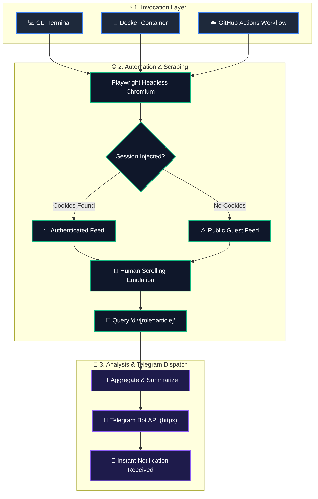

<div align="center">

# 🕷️ Scrapy
### *Automated Event-Driven Web Intelligence & Market Research Monitor*

[](https://www.python.org/)
[](https://playwright.dev/python/)
[](https://core.telegram.org/bots/api)
[](https://www.docker.com/)
[](LICENSE)

<br/>

[🚀 **Run on GitHub Actions**](https://github.com/MohamedElmutasim/scrapy/actions) • 
[📖 **Setup Guide**](#-quick-start) • 
[💬 **Configure Telegram**](https://t.me/BotFather) • 
[🐛 **Report an Issue**](https://github.com/MohamedElmutasim/scrapy/issues)

</div>

---

## 📑 Interactive Table of Contents

- [🎯 System Overview](#-system-overview)
- [🔄 Interactive Workflow Diagram](#-interactive-workflow-diagram)
- [⚡ Execution Modes Matrix](#-execution-modes-matrix)
- [🚀 Quick Start](#-quick-start)
  - [Option A: Local Environment](#option-a-local-environment)
  - [Option B: Docker Container](#option-b-docker-container)
  - [Option C: Serverless GitHub Actions](#option-c-serverless-github-actions)
- [⚙️ Configuration & Secrets](#️-configuration--secrets)
  - [Cookie Session Extraction](#-step-by-step-cookie-session-setup)
- [🖥️ Live Execution Simulation](#️-live-execution-simulation)
- [❓ Interactive FAQ & Troubleshooting](#-interactive-faq--troubleshooting)
- [🗺️ Development Roadmap](#️-development-roadmap)
- [📄 License](#-license)

---

## 🎯 System Overview

**Scrapy** automatically monitors targeted social groups, forums, and discussion boards for competitive intelligence and market research.

```
┌────────────────────────────────────────────────────────────────────────┐
│  1. Authenticates session using saved browser cookies                  │
│  2. Emulates natural human reading habits (organic scrolling intervals)│
│  3. Traverses lazy-loaded feeds & extracts top discussion posts        │
│  4. Compiles structured digests & dispatches instant Telegram alerts   │
└────────────────────────────────────────────────────────────────────────┘
```

---

## 🔄 Interactive Workflow Diagram



---

## ⚡ Execution Modes Matrix

| Feature | 💻 Local Run | 🐳 Docker | ☁️ GitHub Actions |
| :--- | :---: | :---: | :---: |
| **Setup Time** | 2 min | 1 min | **Zero (Cloud)** |
| **Dependencies** | Python 3.10 + Chromium | Docker Engine | None (Managed) |
| **Trigger Mechanism** | Manual Command | Script / Daemon | `workflow_dispatch` / Webhook |
| **Scheduling** | Cron / Task Scheduler | Container Orchestrator | Native Cron in YAML |
| **Best For** | Development & Debugging | Production / Self-Hosted | Automated Cloud Monitoring |

---

## 🚀 Quick Start

<details open>
<summary><h3>💻 Option A: Local Environment (Click to collapse)</h3></summary>

#### 1. Clone the project
```bash
git clone https://github.com/MohamedElmutasim/scrapy.git
cd scrapy
```

#### 2. Create virtual environment
```bash
# macOS / Linux
python3 -m venv venv && source venv/bin/activate

# Windows (PowerShell)
python -m venv venv
.\venv\Scripts\Activate.ps1
```

#### 3. Install dependencies & browser engine
```bash
pip install -r requirements.txt
playwright install chromium
playwright install-deps chromium
```

#### 4. Run the scraper
```bash
python app.py
```

</details>

<details>
<summary><h3>🐳 Option B: Docker Container (Click to expand)</h3></summary>

Run Scrapy in an isolated, pre-configured Ubuntu Jammy container without installing Python or Chromium locally:

```bash
# 1. Build the image
docker build -t scrapy-runner .

# 2. Run with your environment variables
docker run --rm \
  -e TELEGRAM_BOT_TOKEN="your_bot_token" \
  -e TELEGRAM_CHAT_ID="your_chat_id" \
  -e TARGET_URL="https://www.facebook.com/groups/example/" \
  scrapy-runner
```

</details>

<details>
<summary><h3>☁️ Option C: Serverless GitHub Actions (Click to expand)</h3></summary>

Trigger scrapes directly in the cloud on GitHub's infrastructure without running any local servers:

1. Go to your repository **Settings** &rarr; **Secrets and variables** &rarr; **Actions**.
2. Add the following secrets:
   - `TELEGRAM_BOT_TOKEN`: Your Telegram Bot API token from [@BotFather](https://t.me/BotFather).
   - `TELEGRAM_CHAT_ID`: Your chat ID.
   - `TARGET_URL`: Default target group or forum URL.
   - `COOKIES_JSON`: *(Optional)* Your JSON-formatted session cookies.
3. Open the [**Actions Tab**](https://github.com/MohamedElmutasim/scrapy/actions) &rarr; Select **Event-Driven Market Research Scraper** &rarr; Click **Run workflow**.

</details>

---

## ⚙️ Configuration & Secrets

Copy the provided example template into a local `.env` file:

```ini
# ==============================================================================
# Telegram Bot Credentials (Get from @BotFather)
# ==============================================================================
TELEGRAM_BOT_TOKEN="your_telegram_bot_token_here"
TELEGRAM_CHAT_ID="your_telegram_chat_id_here"

# ==============================================================================
# Target Discussion Group or Forum
# ==============================================================================
TARGET_URL="https://www.facebook.com/groups/your_target_group_id/"

# ==============================================================================
# Optional: Base64 or JSON Session Cookies (Overrides local cookies.json)
# ==============================================================================
# COOKIES_JSON='[{"name":"datr","value":"...","domain":".facebook.com","path":"/"}]'
```

<details>
<summary><h3>🍪 Step-by-Step Cookie Session Setup</h3></summary>

To scrape private or member-only groups:

1. **Log in**: Sign in to your target platform in your browser.
2. **Export**: Use an extension like **Cookie-Editor** or **EditThisCookie** to export cookies as JSON.
3. **Save Safely**:
   - **Local usage:** Save as `cookies.json` in the root folder *(this file is strictly ignored by `.gitignore`)*.
   - **Cloud usage:** Paste the JSON string into the `COOKIES_JSON` secret in GitHub Repository Secrets.

</details>

---

## 🖥️ Live Execution Simulation

Here is what a live scrape run looks like:

```text
[15:30:00] INFO - 🚀 Starting Playwright scraper for URL: https://facebook.com/groups/example
[15:30:02] INFO - Launching headless Chromium browser...
[15:30:04] INFO - ✅ Injected cookies from environment variable.
[15:30:05] INFO - Navigating to target group...
[15:30:08] INFO - Simulating human reading (scrolling)...
[15:30:14] INFO - Found 5 post elements matching 'div[role="article"]'
[15:30:15] INFO - Ensuring all Playwright resources are closed to free RAM...
[15:30:15] INFO - ✅ Playwright resources cleaned up.
[15:30:16] INFO - Sending report to Telegram...
[15:30:17] INFO - ✅ Report sent to Telegram successfully!
```

#### 📱 Telegram Alert Preview

> 📊 **تحليل مبدئي لبيانات الجروب (Event-Driven Runner)**
> 
> تم جلب منشورات بطول **3,420** حرفاً.
> 
> 🔹 **المنشور 1**:
> *السلام عليكم، هل يوجد ترشيح لأفضل برنامج لإدارة المخازن متوافق مع الفواتير الإلكترونية؟...*
> 
> 🔹 **المنشور 2**:
> *تجربتي مع زيادة سرعة المتاجر الإلكترونية وتقليل تكلفة الإعلانات بنسبة 40%...*

---

## ❓ Interactive FAQ & Troubleshooting

<details>
<summary><b>1. Why did Telegram return HTTP 400 Bad Request?</b></summary>
<br/>
Telegram enforces a strict limit of <b>4,096 characters per message</b>. If the combined text of your scraped posts exceeds this length, truncate the text or implement message chunking in <code>app.py</code>.
</details>

<details>
<summary><b>2. How can I schedule the scraper to run automatically every 6 hours?</b></summary>
<br/>
In <code>.github/workflows/scrape.yml</code>, add a <code>schedule</code> trigger:

```yaml
on:
  schedule:
    - cron: '0 */6 * * *'  # Runs every 6 hours
  workflow_dispatch:
```
</details>

<details>
<summary><b>3. What if the platform changes its post CSS selector?</b></summary>
<br/>
You can update the selector in <code>app.py</code>:
```python
CSS_SELECTOR = 'div[role="article"]'  # Modify to match new target elements
```
</details>

---

## 🗺️ Development Roadmap

- [x] **Core Scraping Engine** (Playwright + Headless Chromium)
- [x] **Session Injection** (Local JSON & Encrypted Environment Strings)
- [x] **Human Scrolling Simulation** (Anti-bot evasion)
- [x] **Instant Telegram Alerts** (Asynchronous HTTPX dispatcher)
- [x] **Serverless Workflow** (GitHub Actions trigger)
- [ ] **AI Semantic Analysis** (OpenAI / DeepSeek integration for pain-point & sentiment extraction)
- [ ] **Automatic Telegram Message Chunking** (Auto-split responses over 4,000 characters)
- [ ] **Multi-Group Batch Scraping** (Support list of URLs in parallel)

---

## 📄 License

Distributed under the **MIT License**. See `LICENSE` for more information.
